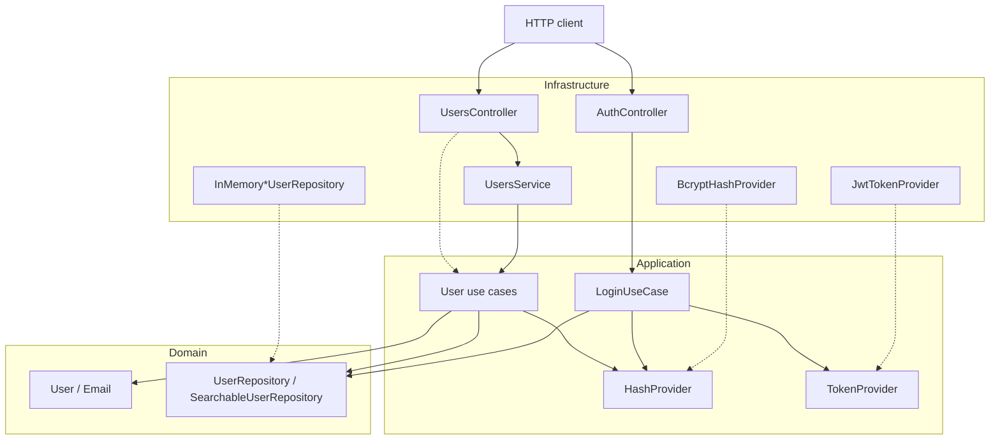

# ti-syscalls-backend

Backend for an IT support ticket system. Organizations should be able to register people, assign roles, and eventually open and track technical support requests.

This repository is a study project. The goal is not a finished helpdesk product. It is a realistic NestJS/TypeScript backend used to practice Domain-Driven Design, Clean Architecture, and the kind of engineering decisions those ideas force once the code starts growing.

The first bounded context in place is **Users**. Ticket management is the intended product, but it is not implemented yet.

**Status:** early development (`0.0.1`). Experimental. Not a production deployment.

## Context

A support desk needs more than a ticket table. People sign up, emails have to be valid and unique, passwords cannot be stored in plain text, and roles change what someone is allowed to do later (`user`, `technician`, `admin`).

That is the slice this backend currently models. HTTP exists as a NestJS REST API with signup, login, JWT authentication, and role/ownership authorization. Persistence is still in-memory.

Who this code is for today:

- people who will become requesters, technicians, or admins;
- developers studying how a NestJS app can keep domain rules out of controllers and database adapters.

## Features

What the code actually does today:

- **User domain model** — identity, name, email, password, and role (`user`, `technician`, `admin`).
- **User registration rules** — `SignupUseCase` validates required fields, normalizes email, rejects duplicates, hashes the password, and inserts the user through a repository port.
- **Email as a value object** — trim, lowercase, format check, value equality.
- **Password hashing** — `HashProvider` port with a `bcryptjs` adapter (cost factor 12).
- **In-memory user persistence** — insert, find by id/email, list, update, delete.
- **Searchable users** — filter by query (name or email), name, email, and role; sort by `name`, `email`, or `role`; paginate (default page `1`, per page `15`).
- **Users HTTP resource** — NestJS `UsersController` under `/users`. `POST` registers a user through `SignupUseCase`; `GET`, `PATCH`, and `DELETE` run their own use cases, with validation, pagination, filtering, and ordering.
- **Authentication** — `POST /auth/login` verifies the password with bcrypt and issues a signed JWT.
- **Authorization** — global JWT guard, role-based access (`user`, `technician`, `admin`), and ownership checks in the application layer.
- **Protected user operations** — only admins can delete users or change roles; users can read and update only their own profile.

What is **not** implemented:

- ticket/syscall lifecycle;
- refresh tokens, token revocation, or password reset;
- PostgreSQL or any other database;
- Docker;
- OpenAPI/Swagger.

## Tech stack

Confirmed from `package.json` and source:

| Area | Choice |
| ---- | ------ |
| Language | TypeScript |
| Runtime | Node.js |
| HTTP framework | NestJS 11 (`@nestjs/platform-express`) |
| API style | REST |
| Authentication | JWT (`@nestjs/jwt`) |
| Configuration | `@nestjs/config` with boot-time validation |
| Password hashing | `bcryptjs` |
| Tests | Jest, ts-jest, Supertest |
| Lint / format | ESLint, Prettier |

There is no ORM, migration tool, or container setup in this repository.

## Architecture

The problem this structure tries to solve is coupling. If user rules live in a NestJS service that talks to Express DTOs and a database at the same time, changing storage, hashing, or HTTP shape starts rewriting business logic.

The code is organized so that:

1. **Domain** owns the rules and the language of the model.
2. **Application** orchestrates use cases against domain ports.
3. **Infrastructure** adapts NestJS, in-memory storage, and bcrypt to those ports.

Presentation is not a separate top-level folder. HTTP controllers and the NestJS `UsersService` live under `infrastructure`, which is how NestJS modules are currently composed.



`UsersService` is a NestJS provider in infrastructure — the path `UsersController` actually calls. The user use cases are wired in `UsersModule`; `LoginUseCase` is wired in `AuthModule`, which imports `UsersModule` to reuse the same repository and hash provider. `JwtAuthGuard` and `RolesGuard` are registered as global guards, so every route is protected unless marked `@Public()`.

### How dependencies flow

- `src/users/domain` does not import NestJS, bcrypt, JWT, or HTTP types.
- Shared repository ports in `src/shared/domain/repositories` only talk about entities, ids, filters, and pagination.
- Application code depends on those ports, not on a storage engine or token implementation.
- Infrastructure implements the ports: `InMemoryUserRepository`, `InMemorySearchableUserRepository`, `BcryptHashProvider`, `JwtTokenProvider`.
- `src/auth` depends on the users domain/repository contracts, not the other way around.
- NestJS stays at the edges: `AppModule`, `UsersModule`, `AuthModule`, controllers, and `UsersService`.

That is the dependency rule in practice: domain does not know how it is stored or exposed.

### Bounded context

Only one business context exists: **Users**, under `src/users`. Authentication lives in `src/auth`, a supporting module that depends on Users. Shared kernel code lives in `src/shared` (repository contracts, `DomainError`, `HashProvider`, `ForbiddenError`, configuration).

`UserRole.TECHNICIAN` is a hint of the support-desk domain that is still missing. There is no tickets module.

## Project structure

```text
src/
├── main.ts
├── app.module.ts
├── auth/
│   ├── application/
│   │   ├── errors/                InvalidCredentialsError
│   │   ├── providers/             TokenProvider port
│   │   └── use-cases/             LoginUseCase
│   ├── infrastructure/
│   │   ├── decorators/            Public, Roles, CurrentUser
│   │   ├── guards/                JwtAuthGuard, RolesGuard
│   │   ├── providers/             JwtTokenProvider
│   │   ├── auth.controller.ts
│   │   ├── auth.module.ts
│   │   └── auth.providers.ts
│   └── presentation/              LoginDto, LoginResponseDto
├── shared/
│   ├── application/
│   │   ├── errors/                ForbiddenError
│   │   └── providers/             HashProvider port
│   ├── domain/
│   │   ├── global-contract.error.ts
│   │   └── repositories/          Repository, SearchableRepository
│   └── infrastructure/
│       ├── config/                boot-time environment validation
│       └── http/                  global exception filter
└── users/
    ├── application/
    │   ├── errors/
    │   ├── types/                 Actor
    │   └── use-cases/             Signup, Get, Update, Delete, Search
    ├── domain/
    │   ├── entities/              User, UserRole
    │   ├── errors/
    │   ├── repositories/          UserRepository, SearchableUserRepository
    │   └── value-objects/         Email
    ├── infrastructure/
    │   ├── providers/hash-provider/
    │   ├── repositories/          in-memory adapters
    │   ├── users.controller.ts
    │   ├── users.service.ts
    │   └── users.module.ts
    └── presentation/              DTOs and User output presenter
```

Tests sit next to the code they cover, usually under `__tests__/unit`. End-to-end tests live in `test/`.

## Domain concepts

Only concepts that exist in the code are listed here.

### Entity — `User`

`User` is the user aggregate in practice, even though the class is not labeled as an aggregate root.

It owns:

- a UUID generated with `crypto.randomUUID()`;
- `name`;
- `Email`;
- `password`;
- `UserRole` (`user` | `technician` | `admin`, default `user`).

Behavior stays on the entity: `User.create()`, `updateName()`, `updateEmail()`, `assignRole()`, `hasPassword()`. Name is trimmed. Invalid emails never enter the model.

### Value object — `Email`

`Email` is created only through `Email.create(raw)`. It trims, lowercases, rejects empty values, validates format, and compares by value (`equals`).

### Repository ports

Shared ports:

- `Repository<TEntity, TId>` — `insert` and `findById` only. Update, delete, and aggregate-specific queries stay on the aggregate contract, because failure rules are not the same for every entity.
- `SearchableRepository<TEntity, TFilter, TSortField>` — search, pagination, and ordering. It does **not** extend `Repository`. A searchable read model should be allowed to exist without writes or identity lookup.

User ports:

- `UserRepository` extends `Repository<User, string>` and adds `findAll`, `findByEmail`, `update`, `delete`.
- `SearchableUserRepository` extends both `UserRepository` and `SearchableRepository`. `UserFilter` supports `query`, `name`, `email`, and `role`. Sortable fields are `name`, `email`, and `role`.

Adapters live in infrastructure. They implement the contracts; they do not define them.

### Use case — `SignupUseCase`

Application-layer registration:

1. reject missing `name`, `email`, or `password`;
2. create an `Email` value object;
3. reject an email that already exists (`findByEmail`);
4. hash the password through `HashProvider`;
5. create a `User` and `insert` it;
6. return `{ id, name, email, role }` without the password.

This use case is covered by unit tests and bound to `POST /users` through `UsersService`.

### Use case — `LoginUseCase`

Application-layer authentication:

1. normalize the e-mail through the `Email` value object;
2. find the user by e-mail (`findByEmail`);
3. compare the supplied password with the stored hash (`compareHash`), using a dummy hash when the user does not exist to keep the failure path expensive;
4. throw `InvalidCredentialsError` with a generic message for both unknown e-mail and wrong password;
5. issue a JWT containing `sub`, `email`, and `role`;
6. return `{ accessToken, user }` without the password.

Authentication never reveals whether an e-mail exists. The token is accepted by the global `JwtAuthGuard` and its `role` claim is used by `RolesGuard`.

### Ports / providers

- `HashProvider` (`generateHash`, `compareHash`) in `src/shared/application/providers`.
- `BcryptHashProvider` in users infrastructure.
- `TokenProvider` (`generate`, `verify`) in `src/auth/application/providers`.
- `JwtTokenProvider` in auth infrastructure.

### DTOs

`CreateUserDto` and `UpdateUserDto` live in `src/users/presentation`. `LoginDto` and `LoginResponseDto` live in `src/auth/presentation`. They are HTTP shapes, not domain types. `UpdateUserDto` repeats the create fields as optional.

### Errors

- `DomainError` — shared base error with optional `details` and `httpStatus`.
- `BadRequestException` — used for missing fields and invalid update payloads.
- `UsersAlreadyExistError` — duplicate e-mail, mapped to `409`.
- `NotFoundException` — unknown user, mapped to `404`.
- `InvalidCredentialsError` — login failure, mapped to `401`.
- `ForbiddenError` — ownership/role denial, mapped to `403`.

There are no domain events and no dedicated domain services.

## API

No Swagger. NestJS listens on `process.env.PORT` or **3000**.

All routes are protected by default. Send the token returned by `POST /auth/login` as:

```text
Authorization: Bearer <accessToken>
```

Routes marked as public use `@Public()`. Protected routes return `401` without a valid token and `403` when the authenticated role is insufficient.

### Permission matrix

| Endpoint | Public | `user` | `technician` | `admin` |
| --- | --- | --- | --- | --- |
| `GET /` | yes | — | — | — |
| `POST /auth/login` | yes | — | — | — |
| `POST /users` | yes | — | — | — |
| `GET /users` | no | no | yes | yes |
| `GET /users/:id` | no | own user | any | any |
| `PATCH /users/:id` | no | own name/e-mail | no | any, including `role` |
| `DELETE /users/:id` | no | no | no | yes |

### `GET /`

Health/hello endpoint from the Nest starter. Public.

**Response:** `200` with body `Hello World!`

```bash
curl http://localhost:3000/
```

### `POST /auth/login`

Authenticates a user and returns a JWT.

**Body:**

```json
{
  "email": "jane.doe@example.com",
  "password": "secretPassword123"
}
```

**Response:** `200` with `{ accessToken, user: { id, name, email, role } }`. The password is never returned. Unknown e-mail and wrong password both return `401` with `Invalid email or password`.

```bash
curl -X POST http://localhost:3000/auth/login \
  -H "Content-Type: application/json" \
  -d '{"email":"jane.doe@example.com","password":"secretPassword123"}'
```

### `POST /users`

Public registration through `SignupUseCase`. It validates required fields, normalizes the e-mail, rejects duplicates, hashes the password, and persists the user.

**Body:**

```json
{
  "name": "Jane Doe",
  "email": "jane.doe@example.com",
  "password": "secretPassword123"
}
```

`role` is not part of the registration contract. Any `role` sent by an anonymous client is stripped by the validation whitelist, so signup always creates a `user`.

**Response:** `201` with `{ id, name, email, role }` (no password).

```bash
curl -X POST http://localhost:3000/users \
  -H "Content-Type: application/json" \
  -d '{"name":"Jane Doe","email":"jane.doe@example.com","password":"secretPassword123"}'
```

### `GET /users`

Search users with filtering, sorting, and pagination. Requires `admin` or `technician`.

Query parameters: `query`, `name`, `email`, `role`, `sort` (`name`, `email`, `role`), `sortDirection` (`asc`, `desc`), `page` (default `1`), `perPage` (default `15`).

**Response:** `200` with `{ items, total, currentPage, perPage, lastPage, sort, sortDirection, filter }`.

```bash
curl "http://localhost:3000/users?role=technician&sort=name&page=1" \
  -H "Authorization: Bearer $TOKEN"
```

### `GET /users/:id`

Returns a user. A `user` can read only their own record; `technician` and `admin` can read any record. Unknown ids return `404`.

### `PATCH /users/:id`

Updates `name` and/or `email`. A `user` can update only their own name/e-mail; `technician` cannot update other users; `admin` can update any user and change `role`. A non-admin trying to change `role` receives `403`.

Body: any subset of `{ name, email, role }`. Unknown roles and invalid e-mails return `400`; duplicate e-mails return `409`.

### `DELETE /users/:id`

Removes a user. Requires `admin`. Returns `204`; unknown ids return `404`.

## Persistence

There is no database in this project.

Users are kept in process memory:

- `InMemoryUserRepository` implements `UserRepository`;
- `InMemorySearchableUserRepository` extends it and implements `SearchableUserRepository`.

Data is lost when the process stops. That is enough to test repository contracts and use cases without coupling them to SQL.

## Running locally

### Prerequisites

- Node.js 20+ (NestJS 11)
- npm

### Install

```bash
npm install
```

### Development

```bash
npm run start:dev
```

Watch mode. Default URL: `http://localhost:3000`.

Other start scripts:

```bash
npm run start          # nest start
npm run start:debug    # nest start --debug --watch
```

### Production build

```bash
npm run build
npm run start:prod
```

`start:prod` runs `node dist/main`.

### Lint and format

```bash
npm run lint
npm run format
```

There is no Docker setup and no migration command.

## Environment variables

`.env.example` documents the expected variables. `ConfigModule` loads `.env` and validates the configuration at boot; an invalid environment fails fast.

| Variable | Description | Required |
| -------- | ----------- | -------- |
| `PORT` | HTTP port. Defaults to `3000`. | no |
| `JWT_SECRET` | Secret used to sign and verify JWTs. | yes |
| `JWT_EXPIRES_IN` | Token lifetime. Defaults to `1h`. | no |

`.gitignore` ignores `.env*` files, except `.env.example`. Copy it to `.env` for local development.

## Tests

Jest is configured in `package.json` (`rootDir: src`, files matching `.*\.spec\.ts$`). E2E uses `test/jest-e2e.json`.

```bash
npm test           # unit tests
npm run test:watch
npm run test:cov
npm run test:e2e
npm run test:debug
```

Where tests live:

| Area | Location |
| ---- | -------- |
| User entity | `src/users/domain/entities/__tests__/unit` |
| Email VO | `src/users/domain/value-objects/__tests__/unit` |
| Search contracts | `src/shared/domain/repositories/__tests__/unit` |
| User repository ports | `src/users/domain/repositories/__tests__/unit` |
| In-memory adapters | `src/users/infrastructure/repositories/__tests__/unit` |
| User use cases | `src/users/application/use-cases/__tests__/unit` |
| `BcryptHashProvider` | `src/users/infrastructure/providers/hash-provider/__tests__/unit` |
| JWT adapter and guards | `src/auth/infrastructure/{providers,guards}/__tests__/unit` |
| `LoginUseCase` | `src/auth/application/use-cases/__tests__/unit` |
| Nest controller/service | `src/users/infrastructure/__tests__` |
| Environment validation | `src/shared/infrastructure/config/__tests__` |
| Exception filter | `src/shared/infrastructure/http/__tests__` |
| E2E (hello, auth, users) | `test/app.e2e-spec.ts`, `test/users.e2e-spec.ts` |

Domain and use-case tests talk to in-memory repositories and fake hash/token providers. E2E boots the real `AppModule` and covers login, protected routes, role checks, and the full Users REST surface.

## Architectural decisions

**DDD, but only where it pays rent.** Users already have invariants (email format, default role, name trimming). Those rules sit on `User` and `Email`, not in the controller. Tickets are not modeled yet, so there is no fake ubiquitous language around them.

**Clean Architecture as a dependency rule, not a folder religion.** Domain contracts stay in domain directories. Storage and bcrypt stay in infrastructure. Shared search/pagination types stay generic; `UserFilter` stays in the users context so the shared port never learns what a user is.

**Repository is not a generic CRUD.** `Repository` only has `insert` and `findById`. Search is a separate port. That keeps a read-only search implementation possible and stops every aggregate from inheriting the same update/delete semantics.

**Hashing is an application port.** `SignupUseCase` and `LoginUseCase` depend on `HashProvider`, not bcrypt. `BcryptHashProvider` is the adapter. Tests inject a fake provider and assert the stored password is the hash, not the raw input.

**Authentication is a supporting module.** `src/auth` depends on the Users repository and hash contracts. Tokens are generated by `TokenProvider`, whose JWT adapter lives in auth infrastructure.

**Authorization is split by concern.** Guards decide transport-level access (authenticated? role allowed?). Ownership and "only admins change roles" rules live in the use cases, where they can be tested without HTTP.

**Default deny.** `JwtAuthGuard` and `RolesGuard` are global. New routes are protected unless explicitly marked `@Public()`, which avoids forgetting a guard on a new controller.

**In-memory first.** An in-memory adapter is enough to lock repository and use-case behavior. A SQL adapter can implement the same ports later without rewriting `User`, `SignupUseCase`, or `LoginUseCase`.

**NestJS is the delivery mechanism.** Modules and controllers compose the app. The domain layer can be unit-tested without creating a Nest testing module.

Current trade-offs that follow from those choices:

- The role is embedded in the JWT, so a role change only takes effect when the user logs in again (or the short token expires).
- There is no refresh token, revocation list, or password reset yet.
- In-memory storage is single-process and loses data on restart.

## Roadmap

Nothing here is scheduled. It is just what the code is already leaning toward:

- replace in-memory storage with a real database behind the same ports;
- add refresh tokens, token revocation, and password reset;
- introduce the tickets/syscalls bounded context that the repository name points to;
- add OpenAPI/Swagger, health checks, and a CI pipeline.

## License

MIT. See [LICENSE](LICENSE).
